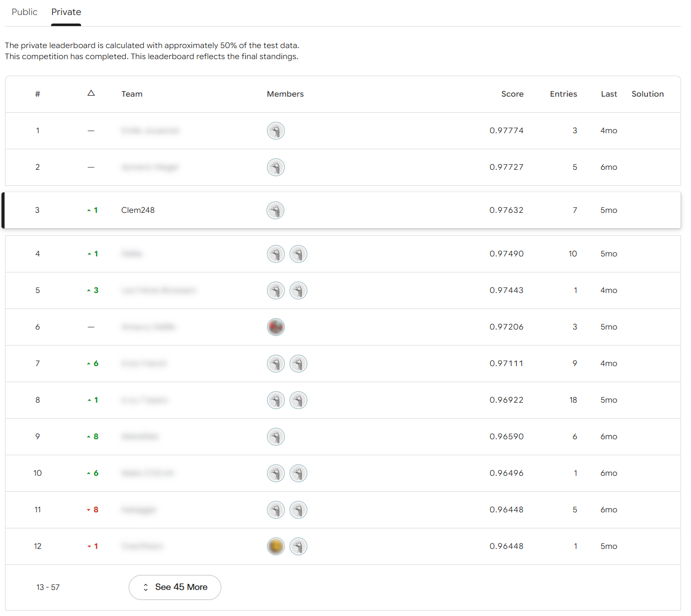

# VanillaNet-7 for ship classification

PyTorch reimplementation of VanillaNet ([Chen et al., NeurIPS 2023](https://arxiv.org/abs/2305.12972)) for an image classification competition run on Kaggle within the AI major of EPITA. The model classifies 192×128 grayscale images into 10 types of ships. It ranked 3rd of 56 teams, with 97.63% accuracy on the private leaderboard (1st: 97.77%).

After training, the layers of each block are fused as described in the paper. The fused model has 2.4× fewer parameters and runs 2.3× faster at batch size 1, on CPU and GPU, with the same outputs up to floating-point error.

## Results

The test set has 4,224 images, split by Kaggle into two halves of about the same size.

| Leaderboard | Accuracy |
|---|---|
| Public | 98.30% |
| Private (final ranking) | 97.63%, 3rd of 56 (1st: 97.77%) |



The leaderboard lists 57 entries because it includes the teacher's.

The table below compares the model as trained, the same model after fusion, and a fused model with every channel count halved. Weights do not affect these numbers, so they can be reproduced without a checkpoint using `scripts/benchmark.py`. Latencies are medians in fp32 (TF32 convolutions on GPU, the PyTorch default), on an AMD Ryzen 5 5600X (6 threads) and an RTX 5070 Ti.

| Model | Params | MACs per image | CPU, batch 1 | GPU, batch 1 | GPU, batch 64 |
|---|---|---|---|---|---|
| Training-time, full width | 69.4M | 11.5G | 94 ms | 2.3 ms | 790 img/s |
| Fused, full width | 29.5M | 4.7G | 41 ms | 1.0 ms | 1,560 img/s |
| Fused, half width | 7.6M | 1.2G | 13 ms | 1.0 ms | 3,740 img/s |

Fusion replaces the five operations that precede each SIAF with a single convolution, which divides the latency by 2.3 on both devices. Halving the width divides the parameters by 3.9 and the CPU latency by 3.1, but does not change the GPU latency at batch size 1: with a single image the GPU is mostly idle, and the time is spent running the layers one after the other rather than computing. This is the argument the paper makes for shallow networks. At batch size 64 the GPU is busy and the smaller model processes 2.4× more images per second. In my competition runs, the half-width model scored about 1 point lower.

## Task

The training set contains 37,980 images in 10 classes: coastguard, container ship, corvette, cruiser, aircraft carrier, destroyer, LNG carrier, small fishing boat, submarine and tug. Classes are imbalanced, from 1,826 to 6,266 images.

The competition rules excluded pretrained weights and limited the depth of the network to 30 layers, counting convolution, batch norm, linear and dropout layers. The training-time model uses exactly 30 (18 convolutions, 11 batch norms, 1 dropout). The fused model has 13.

The dataset was provided by the school and may be reused in later years, so it is not included in this repository.

## Approach

VanillaNet reaches the accuracy of much deeper networks with very few layers. Two ideas make this possible.

The first is the series informed activation function (SIAF). Each channel gets a learned bias and a ReLU, then a learned weighted sum over a 7×7 neighbourhood, which is a depthwise convolution. The 1×1 convolutions mix channels and the SIAF mixes neighbouring pixels, so each block adds a lot of non-linearity at a small cost.

The second is deep training. Each block contains two 1×1 convolutions, each followed by a batch norm, with an activation between them:

```
conv1x1 → BN → act(λ) → conv1x1 → BN → SIAF
```

The activation is `(1 - λ)·ReLU(x) + λ·x`. λ grows linearly from 0 to 1 over the first 200 of the 300 epochs, so the block starts with a ReLU between the two convolutions and ends with none. Once λ = 1, everything before the SIAF can be replaced by a single convolution:

```
conv1x1 → ReLU → depthwise 7×7
```

The fusion is implemented in [`fusion.py`](src/vanillanet_ships/fusion.py) in three steps. A batch norm with statistics $\mu, \sigma^2$ and parameters $\gamma, \beta$ is folded into the preceding convolution:

$$W' = W \cdot \frac{\gamma}{\sigma}, \qquad b' = (b - \mu) \cdot \frac{\gamma}{\sigma} + \beta, \qquad \sigma = \sqrt{\sigma^2 + \epsilon}$$

Two 1×1 convolutions in a row apply the same linear map to every pixel, so they compose like matrices:

$$W = W_2 W_1, \qquad b = W_2 b_1 + b_2$$

Finally, the SIAF bias is added before the ReLU, so it is absorbed into the bias of the fused convolution. The convolution, batch norm and SIAF bias of the stem are fused in the same way. [`tests/test_fusion.py`](tests/test_fusion.py) checks each step separately and checks that the fused network gives the same outputs as the original one.

## Training

The model is trained for 300 epochs with AdamW (learning rate 5e-4, weight decay 0.1), 5 warm-up epochs and cosine decay, batch size 64 with 2 accumulation steps. As in the paper, the loss is a binary cross-entropy on soft targets, which handles label smoothing (0.12) and mixed images directly. Each batch goes through either mixup (α = 0.2) or cutmix (α = 1.0). Images are also randomly cropped, flipped, rotated, translated, sharpened and partially erased. The evaluated model is an exponential moving average of the weights (decay 0.999). Training uses mixed precision and gradient clipping.

At test time, each image is classified from 10 views: 5 crops covering 90% of the image, each with and without a horizontal flip. The logits of the views are summed.

The hyperparameters were tuned on a run that kept 20% of the training set for validation. Validation accuracy was close to its maximum after about 240 epochs. The final model was then trained on the whole training set, which took 10 to 11 hours on an RTX 5070 Ti. The full configuration is in [`configs/vanillanet7.yaml`](configs/vanillanet7.yaml).

Some things did not help. RandAugment, used in the paper, gave lower accuracy than the simpler augmentations above. Stronger augmentation or regularisation, meant to reduce overfitting (the final model reaches 100% accuracy on its training set), made training collapse. A second model trained with another seed did not improve the score when averaged with the first. Gradient accumulation made no measurable difference but was kept in the final run.

## Differences from the paper

The stem takes 1 input channel instead of 3, since the images are grayscale. Channel counts are those of VanillaNet-7 in the paper.

The optimizer is AdamW instead of LAMB, which the paper uses for large-batch training on ImageNet.

The data augmentation is the recipe described above instead of RandAugment.

In this repository, the convolutions followed by a batch norm have no bias, since the batch norm cancels it. The model that competed had these redundant biases (about 25k parameters out of 69M). Apart from this, the model and the training recipe are those of the [competition notebook](notebooks/competition_notebook.ipynb).

## Usage

```bash
pip install -e ".[dev]"
pytest
```

The benchmark does not need any data:

```bash
python scripts/benchmark.py
python scripts/benchmark.py --device cuda
```

Training and prediction expect the competition data, with the training images in one folder per class and the test images in a uint8 array of shape (N, 128, 192):

```bash
python scripts/prepare_data.py --images-dir dataset/ships_gray/ships_gray --output data/train_set.npz
python scripts/train.py --config configs/vanillanet7.yaml --data data/train_set.npz --output-dir runs/vanillanet7
python scripts/predict.py --checkpoint runs/vanillanet7/model.pt --images dataset/test_images.npy
```

Training writes a log at each epoch and a checkpoint every 10 epochs; running the same command again resumes from the last checkpoint. Prediction fuses the model unless `--no-fuse` is given.

```
configs/        training configurations (full and half width)
notebooks/      the notebook submitted for the competition, with its outputs
scripts/        command-line entry points
src/vanillanet_ships/
  model.py      training-time and fused architectures
  fusion.py     batch norm and convolution fusion
  data.py       dataset and augmentations
  augment.py    label smoothing, mixup, cutmix
  train.py      training loop
  predict.py    test-time augmentation and inference
tests/
```

## Limitations

The final model was trained without a validation set, so its accuracy is only known from the leaderboard. The hyperparameters come from a single validation run with a single seed.

The trained weights of the competition were not kept, nor the logs of the validation runs. Only the log of the final run survives, in the output of the notebook. The gap of about 1 point of the half-width model comes from the competition runs and has not been measured again with this code.

The benchmarks were run on one machine. CPU latency depends on the processor and the number of threads, and GPU latency at batch size 1 varied by about 10% between runs.

## References

The competition was organised within the AI major (SCIA) at EPITA.

```bibtex
@inproceedings{chen2023vanillanet,
  title     = {VanillaNet: the Power of Minimalism in Deep Learning},
  author    = {Chen, Hanting and Wang, Yunhe and Guo, Jianyuan and Tao, Dacheng},
  booktitle = {Advances in Neural Information Processing Systems},
  year      = {2023}
}
```

## License

MIT
